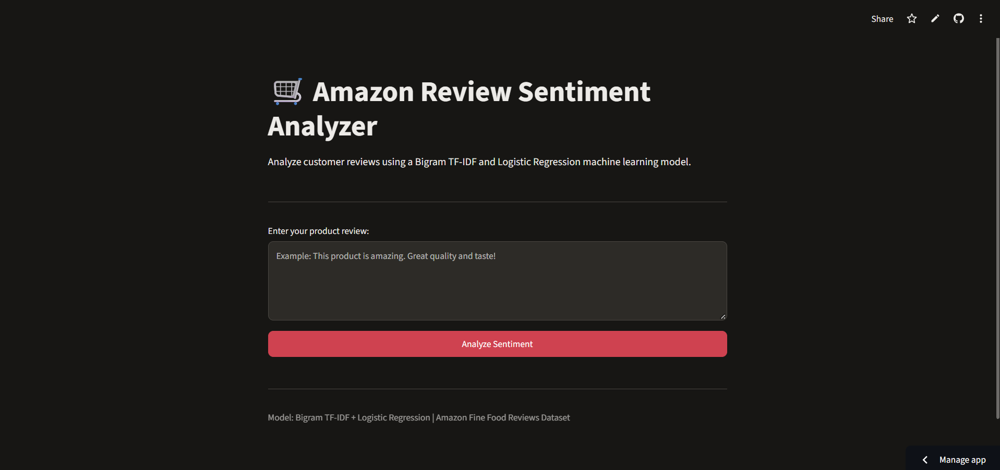
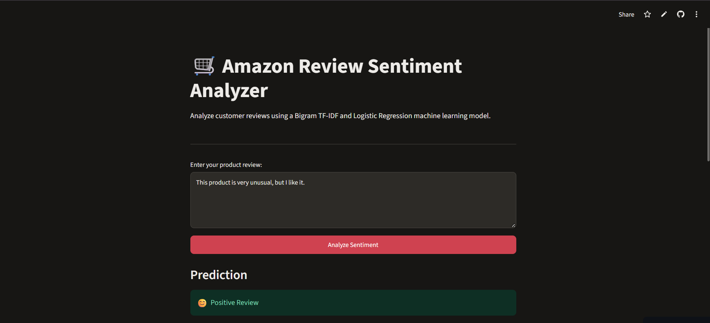
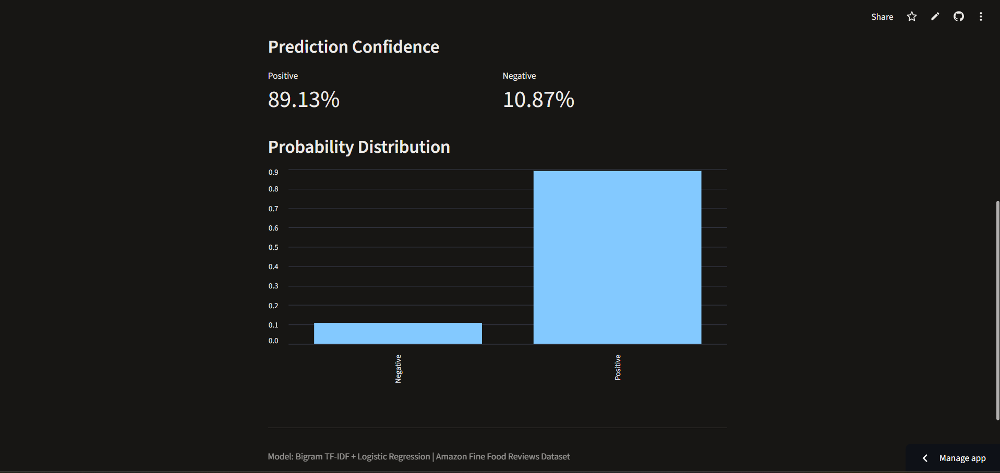
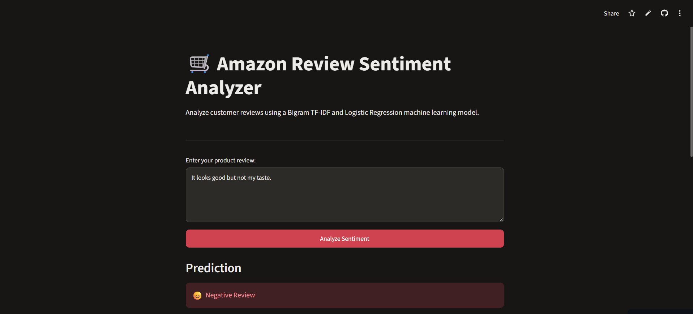
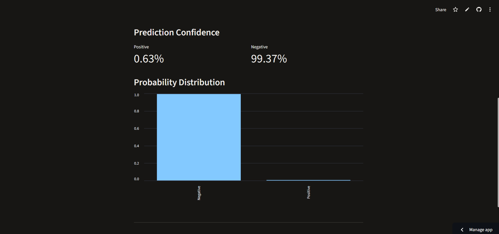

# Amazon Fine Food Reviews — Sentiment Analysis

An end-to-end **Machine Learning and Natural Language Processing (NLP)** project that analyses customer reviews from Amazon and classifies their sentiment as **positive** or **negative**.

The project explores traditional machine learning, word embeddings, and transformer-based approaches, and deploys a Bigram TF-IDF and Logistic Regression model through a Streamlit web application.

<p align="center">
  <a href="https://amazon-fine-food-sentiment-nlp-project.streamlit.app/">
    
  </a>
  <a href="https://github.com/reet25/amazon-fine-food-sentiment">
    
  </a>
  <a href="https://www.kaggle.com/snap/amazon-fine-food-reviews">
    
  </a>
</p>

**Live Application:** [Try the Sentiment Analysis App](https://amazon-fine-food-sentiment-nlp-project.streamlit.app/)

**GitHub Repository:** [amazon-fine-food-sentiment](https://github.com/reet25/amazon-fine-food-sentiment)

**Project Notebook:** [View Jupyter Notebook](amazon-fine-food-reviews.ipynb)

---

## Table of Contents

- [Project Overview](#project-overview)
- [Dataset](#dataset)
- [Project Workflow](#project-workflow)
- [Model Experiments](#model-experiments)
- [Model Evaluation](#model-evaluation)
- [Selected Model](#selected-model)
- [Decision Threshold Optimization](#decision-threshold-optimization)
- [BERT Evaluation](#bert-evaluation)
- [Streamlit Application](#streamlit-application)
- [Repository Structure](#repository-structure)
- [Installation and Usage](#installation-and-usage)
- [Technologies Used](#technologies-used)
- [Key Learnings](#key-learnings)
- [Future Improvements](#future-improvements)
- [Author](#author)

---

## Project Overview

Customer reviews contain valuable information about product experiences, satisfaction, and customer opinions. Manually analysing hundreds of thousands of reviews is time-consuming, so this project uses NLP and machine learning to automate sentiment classification.

The application takes a customer review as input and predicts whether its sentiment is positive or negative.

The project covers the complete machine learning workflow:

- Data exploration and analysis
- Text cleaning and preprocessing
- Sentiment-label creation
- TF-IDF feature extraction
- Logistic Regression modelling
- Unigram and bigram experimentation
- GloVe word embeddings
- Sentence Transformer embeddings
- Fine-tuned BERT
- Model evaluation and comparison
- Error and confidence analysis
- Model serialization
- Streamlit application development and deployment

## Dataset

**Amazon Fine Food Reviews Dataset**

[View Dataset on Kaggle](https://www.kaggle.com/snap/amazon-fine-food-reviews)

The dataset contains customer reviews of fine food products sold on Amazon.

| Attribute | Details |
|---|---|
| Total reviews | 568,454 |
| Total columns | 10 |
| Source | Amazon Fine Food Reviews |
| Task | Binary sentiment classification |
| Input | Customer review text |
| Target | Positive or negative sentiment |

The dataset includes product IDs, user IDs, review scores, review summaries, review text, timestamps, and helpfulness votes.

### Sentiment Label Creation

The original dataset contains ratings from 1 to 5. These ratings were converted into binary sentiment labels:

| Original Rating | Sentiment Label |
|---|---|
| 1, 2, 3 | Negative (0) |
| 4, 5 | Positive (1) |

This formulation converts the problem into a binary classification task.

### Class Distribution

| Sentiment | Number of Reviews |
|---|---:|
| Negative | 124,677 |
| Positive | 443,777 |

The dataset is imbalanced, with positive reviews forming the majority class. This imbalance is considered when interpreting model performance, particularly precision and recall.

## Project Workflow

### 1. Data Loading and Exploration

The dataset was loaded and inspected to understand its structure, data types, missing values, review scores, and sentiment distribution.

Exploratory analysis was used to understand the distribution of ratings and characteristics of the review data before modelling.

### 2. Text Preprocessing

The review text was prepared for NLP modelling. The preprocessing workflow was designed to standardise text and make it suitable for feature extraction and classification.

The review text serves as the primary input for sentiment prediction.

### 3. Train-Test Split

The main dataset was split using an 80:20 stratified train-test split with `random_state=42`.

| Split | Number of Reviews |
|---|---:|
| Training | 454,763 |
| Testing | 113,691 |

Stratification preserves the class distribution across the training and testing sets.

## Model Experiments

Multiple approaches were explored to understand how different text representations and modelling techniques affect sentiment classification.

### 1. TF-IDF with Logistic Regression

TF-IDF converts review text into numerical features based on word importance. Logistic Regression was used as the classification algorithm.

Both unigram and bigram representations were investigated.

- **Unigram TF-IDF:** Represents individual words.
- **Bigram TF-IDF:** Represents individual words as well as consecutive two-word combinations, helping capture short phrases and contextual relationships.

### 2. GloVe Word Embeddings

Pre-trained GloVe embeddings were explored to represent words as dense numerical vectors. These representations capture semantic relationships between words and provide an alternative to sparse TF-IDF features.

### 3. Sentence Transformer Embeddings

Sentence Transformer embeddings were used to represent complete reviews as dense semantic vectors. Logistic Regression was then applied to these representations.

This experiment was evaluated on a 2,000-review subset.

### 4. Fine-Tuned BERT

A pre-trained BERT model was fine-tuned for binary sentiment classification.

This experiment used a separate subset of 5,000 training reviews and 1,000 validation reviews.

Pretrained BERT contextual embeddings were also explored separately using sample sentences and reviews. These exploratory embeddings were not used to train a separate traditional classifier.

BERT results are reported separately from the full-dataset TF-IDF test results because the evaluation sets differ.

## Model Evaluation

The models were evaluated using classification metrics:

- **Accuracy:** Overall proportion of correct predictions.
- **Precision:** Proportion of predicted positive reviews that were actually positive.
- **Recall:** Proportion of actual positive reviews correctly identified.
- **F1-score:** Harmonic mean of precision and recall.
- **ROC-AUC:** Measures the model's ability to distinguish between the two classes across classification thresholds.

### Experimental Results

| Model | Evaluation Data | Accuracy | Precision | Recall | F1-score |
|---|---|---:|---:|---:|---:|
| Unigram TF-IDF + Logistic Regression | Full test set | 0.9016 | 0.9194 | 0.9579 | 0.9382 |
| Bigram TF-IDF + Logistic Regression | Full test set | 0.9288 | 0.9402 | 0.9705 | 0.9551 |
| GloVe + Logistic Regression | Reported evaluation set | 0.8140 | 0.8356 | 0.9483 | 0.8884 |
| Sentence Transformer + Logistic Regression | 2,000-review subset | 0.8330 | 0.8513 | 0.9519 | 0.8988 |
| Fine-tuned BERT | 1,000-review validation subset | 0.9030 | 0.90 | 0.90 | 0.90 |

**Evaluation note:** These experiments were not all evaluated on the same-sized dataset or the same split. The full-test-set TF-IDF results should be compared directly with each other, while the subset-based embedding and BERT experiments should be interpreted separately.

## Selected Model

### Bigram TF-IDF + Logistic Regression

The Bigram TF-IDF model was selected for deployment.

Its full test-set results were:

| Metric | Score |
|---|---:|
| Accuracy | 92.88% |
| Positive-class Precision | 94.02% |
| Positive-class Recall | 97.05% |
| Positive-class F1-score | 95.51% |
| Negative-class Precision | 88.14% |
| Negative-class Recall | 78.05% |
| Negative-class F1-score | 82.79% |
| Macro F1-score | 89.15% |
| ROC-AUC | 96.75% |

The bigram representation performed better than the unigram representation on the reported full test set. Including two-word combinations allows the model to use short phrases in addition to individual words when making predictions.

## Decision Threshold Optimization

A separate threshold optimization experiment was conducted to investigate whether adjusting the classification threshold could improve positive-class performance.

| Metric | Default Threshold | Selected Threshold (0.52) |
|---|---:|---:|
| Accuracy | 92.88% | 92.92% |
| Positive F1-score | 95.51% | 95.53% |

The improvement was marginal. The experiment demonstrates how classification thresholds can influence prediction performance, although the selected threshold was obtained using a temporary model and transferred to the final fitted model.

## BERT Evaluation

The fine-tuned BERT model achieved **90.30% accuracy** on its 1,000-review validation subset.

| Metric | Negative | Positive |
|---|---:|---:|
| Precision | 84% | 92% |
| Recall | 69% | 96% |
| F1-score | 76% | 94% |

### Confusion Matrix

| | Predicted Negative | Predicted Positive |
|---|---:|---:|
| Actual Negative | 151 | 68 |
| Actual Positive | 29 | 752 |

The model correctly classified 903 out of 1,000 reviews. It performed better at identifying positive reviews than negative reviews on this validation subset.

These results should not be interpreted as a direct comparison with the Bigram TF-IDF model because the evaluation datasets differ.

## Streamlit Application

The selected Bigram TF-IDF and Logistic Regression model is packaged for use in a Streamlit application.

Users can enter a customer review and obtain a predicted sentiment.

**[Launch the Live Application](https://amazon-fine-food-sentiment-nlp-project.streamlit.app/)**

### Application Screenshots

### Streamlit Application Interface


### Positive Sentiment Prediction


### Positive Prediction Confidence


### Negative Sentiment Prediction


### Negative Prediction Confidence


## Repository Structure

```text
amazon-fine-food-sentiment/
│
├── amazon-fine-food-reviews.ipynb
├── app.py
├── requirements.txt
├── deployment_vectorizer.pkl
├── deployment_classifier.pkl
├── README.md
│
└── screenshots/
    ├── app-interface.png
    ├── positive-prediction.png
    ├── positive-prediction-confidence.png
    ├── negative-prediction.png
    └── negative-prediction-confidence.png
```

The deployment artifacts contain the fitted Bigram TF-IDF vectorizer and trained Logistic Regression classifier used by the application.

## Installation and Usage

### 1. Clone the Repository

```bash
git clone https://github.com/reet25/amazon-fine-food-sentiment.git
cd amazon-fine-food-sentiment
```

### 2. Create a Virtual Environment

```bash
python -m venv venv
```

Activate it on Windows:

```powershell
venv\Scripts\activate
```

### 3. Install Dependencies

```bash
pip install -r requirements.txt
```

### 4. Run the Streamlit Application

```bash
streamlit run app.py
```

The application will open in your browser, usually at:

```text
http://localhost:8501
```

## Technologies Used

| Category | Tools and Libraries |
|---|---|
| Programming Language | Python |
| Data Manipulation | Pandas, NumPy |
| Data Visualisation | Matplotlib, Seaborn |
| Machine Learning | Scikit-learn |
| NLP and Text Processing | TF-IDF, GloVe |
| Deep Learning / Transformers | Sentence Transformers, BERT |
| Application Framework | Streamlit |
| Model Persistence | Pickle |
| Version Control | Git and GitHub |

## Key Learnings

Through this project, the following concepts and practical skills were explored:

- Preparing and analysing a large-scale text dataset.
- Converting star ratings into binary sentiment labels.
- Understanding class imbalance in sentiment classification.
- Representing text using sparse TF-IDF features and dense embeddings.
- Comparing traditional machine learning with transformer-based approaches.
- Evaluating models using precision, recall, F1-score, and ROC-AUC.
- Performing error analysis and examining prediction confidence.
- Saving trained models and preprocessing objects for inference.
- Building and deploying a machine learning application using Streamlit.

## Future Improvements

Potential extensions include:

- Testing additional NLP architectures and feature representations.
- Expanding error analysis across different types of reviews.
- Evaluating all models on a common held-out test set for a more controlled comparison.
- Improving the application's handling of ambiguous or very short reviews.
- Exploring model monitoring and prediction feedback.

## Author

**Reet Dubey**

B.Tech — Computer Science and Engineering (AI & ML)

VIT Bhopal University

**GitHub:** [reet25](https://github.com/reet25)

**Project Repository:** [Amazon Fine Food Reviews — Sentiment Analysis](https://github.com/reet25/amazon-fine-food-sentiment)

---

*This project was developed as an end-to-end exploration of NLP-based sentiment analysis, from data preparation and model experimentation to application deployment.*
